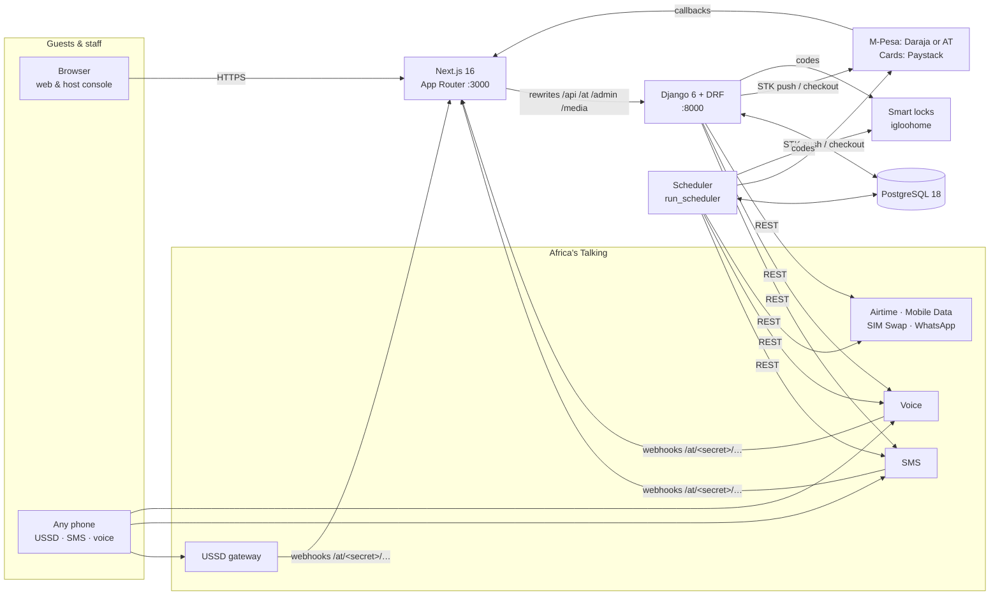
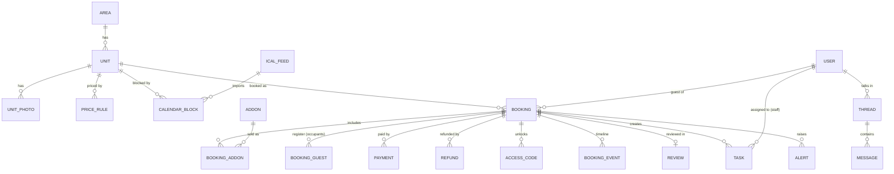
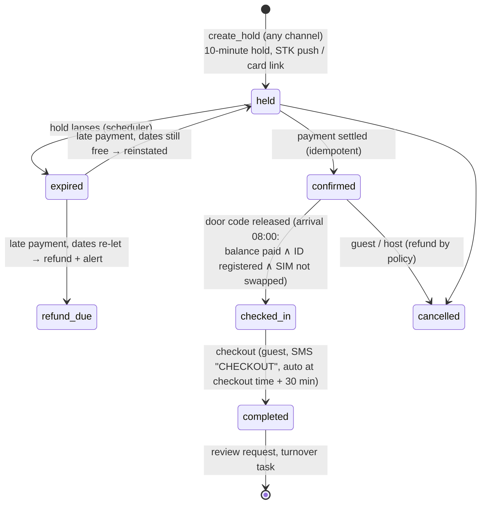

# Architecture

## System overview



There is **one public origin**. Next.js serves the website and proxies the API, admin, media and Africa's Talking webhooks to Django. A single tunnel (ngrok/cloudflared) on port 3000 is all the demo needs, and the browser gets same-origin session cookies with CSRF and no CORS.

## Backend (Django apps)

| App | Responsibility |
|---|---|
| `core` | Site settings (business details, policies, TRA licence, automation switches), activity/audit log, Fernet encryption, the scheduler (jobs, daily markers, Postgres advisory lock), demo endpoints, seed data |
| `accounts` | Phone-number identity (`User` with roles: guest, owner, manager, cleaner, cook, caretaker, security, driver), OTP login, encrypted ID, preferences, data export/erasure, retention purge |
| `properties` | Areas, units (homes), photos, amenities, price rules and overrides, calendar blocks, iCal feeds (import/export), wishlists; availability and the all-in quote engine |
| `bookings` | Booking lifecycle (hold → confirmed → checked in → completed), add-ons and approvals, breakfast, occupants (guest register), access codes, waitlist, risk screening, refunds quote |
| `payments` | Payments and refunds; providers: simulated M-Pesa, Safaricom Daraja, AT mobile checkout, simulated card, Paystack; idempotent settlement; reconciliation |
| `messaging` | Threads, messages (outbox), multilingual templates, automations (message timeline), FAQ knowledge base, broadcasts, GSM-7 encoding, promo-hours guard |
| `comms` | Africa's Talking REST client; the SMS bot ("Ask Amina") and host SMS commands; USSD state machine; voice IVR; SIM-swap checks; webhooks and Demo Lab endpoints |
| `operations` | Tasks/work orders (turnover, maintenance, guest requests), staff, kitchen sheet, gate list, morning digest, guest CRM |
| `safety` | Alerts and the SOS escalation ladder, follow-ups, guest register CSV |
| `reviews` | Ratings by SMS/web with category scores, host responses |
| `insights` | Occupancy, ADR, RevPAR, channel mix, forward bookings, "Today" view, monthly TRA return |

## Data model (core)



## Booking lifecycle



### No double bookings

1. **Database guarantee.** An exclusion constraint makes PostgreSQL refuse two overlapping live stays (`held`, `confirmed`, `checked_in`) for one unit:
   ```sql
   EXCLUDE USING gist (unit_id WITH =, daterange(check_in, check_out, '[)') WITH &&) WHERE (status IN ('held','confirmed','checked_in'))
   ```
   Back-to-back stays are fine (`[)` ranges).
2. **Serialised holds.** `create_hold` locks the unit row (`SELECT … FOR UPDATE`), expires stale holds and re-checks availability, including iCal blocks from Airbnb and Booking.com, inside one transaction. If the constraint still fires, the `IntegrityError` becomes "Sorry — those dates were just taken".
3. **Tested.** Two threads booking the same dates from USSD and the web at the same instant: exactly one wins (`tests/test_booking_engine.py`).

### Payments

- **Pluggable providers.** `MPESA_PROVIDER=simulate|daraja|africastalking`, `CARD_PROVIDER=simulate|paystack`.
- **Callbacks** live under secret paths. Settlement (`payments.services.on_success`) locks the payment row and is safe to call any number of times. It checks the amount and handles late payments: re-hold if the unit is free, otherwise `refund_due` plus an alert to Amina.
- **Reconciliation.** A scheduler job queries pending STK pushes every 2 minutes.
- **Deposits.** 30% now and the balance one day before arrival. The door code waits for the balance, and Kenyan guests get an automatic M-Pesa prompt for it.

### Messaging: an outbox

`messaging.send()` writes a `queued` message in the caller's transaction and dispatches it **after commit** (`transaction.on_commit`), so a rolled-back booking never texts the guest. Anything still queued (crash, AT outage) is re-sent by the scheduler. Other behaviour:
- delivery reports update the status (`delivered`, `failed`);
- seeded demo users are never sent real SMS;
- with no AT key, messages are logged (dry run);
- promotional messages are only sent inside the configured hours (08:00–18:00) and never to opted-out numbers.

### Scheduler

`python manage.py run_scheduler` loops every 30 s. A PostgreSQL advisory lock keeps it single-instance even if several are started. Daily jobs run once per day (database markers), so a restart never repeats them.

| Job | When | What |
|---|---|---|
| `expire_holds` | every tick | Lapsed holds → expired; waitlist notified |
| `outbox` | every tick | Re-send queued messages |
| `release_codes` | from the code-release time (08:00) | Door codes for today's arrivals (gates: balance, ID, SIM swap) |
| `automations` | every tick | Message timeline: confirmation → pre-arrival (D-3) → ID request → directions (D-1) → welcome check → mid-stay → checkout reminder → thanks |
| `auto_checkout` | checkout time + 30 min | Completes forgotten checkouts, revokes codes, creates turnover tasks |
| `reviews` | after checkout | SMS review request (reply 1–5) |
| `alert_followups` | every tick | Escalate unacknowledged SOS alerts (calls Amina, then the backup contact) |
| `payments_reconcile` | 2 min | Query pending STK pushes |
| `ical_sync` | 15 min | Import Airbnb/Booking.com calendars; alert on conflicts |
| `host_digest` | 07:00 | Amina's morning SMS: arrivals, departures, in-house, breakfasts, open tasks, unanswered messages, alerts, week occupancy |
| `gate_list` | 07:30 | Today's arrivals, plates and ETAs to the security guard |
| `kitchen_sheet` | 18:00 | Tomorrow's breakfasts (style, people, time, dietary) to the cook |
| `levy_reminder` | 5th of the month | Last month's tourism levy and TRA return reminder |
| `retention` | 03:00 | Erase ID numbers past the 5-year register period |

## Channels

| Channel | Entry point | Notes |
|---|---|---|
| USSD | `comms/ussd.py` | A cursor replays AT's `*`-joined text chain, so the session is stateless and resilient. Every screen ≤ 160 chars (tested). `0` back, `00` home, `98` more. Separate menus for guests, staff (tasks) and the host (today, approvals, tonight's availability). |
| SMS | `comms/smsbot.py` | Keywords in 5 languages, then the conversation state, then NLU (dates, nights, guests, area), then the FAQ knowledge base, then relay to Amina. HELP is checked first, always. Host commands: `#12 text`, `YES 34`, `NO 34`, `OK`. Staff: `DONE 7`. |
| Voice | `comms/voice.py` | AT voice XML: `<Say>` (Kiswahili voice), `<GetDigits>`, `<Dial>` to Amina, `<Record>` voicemail. DB-backed sessions. Outbound SOS call to Amina ("press 1 to call the guest"). A missed bridged call triggers SMS follow-up or escalation. |
| Web | `frontend/` | Next.js; the same services as every other channel |

## Security & privacy

- **Auth.**
  - Phone number + 6-digit OTP (hashed): 5-minute expiry, lockout after 5 attempts, 30-second resend gap, 5 codes per number per hour, plus per-IP throttles.
  - Session cookie (HttpOnly, SameSite=Lax, Secure in production) with CSRF.
- **Roles.** Guest; host (owner/manager); staff (cleaner, cook, caretaker, security, driver). DRF permission classes (`IsGuest`, `IsHost`, `IsStaffMember`). Guests only ever see their own bookings (404 otherwise).
- **Webhooks.** AT doesn't sign callbacks, so they live under `/at/<AT_WEBHOOK_SECRET>/…`; a wrong secret returns 403. Payment callbacks use their own secret path, and Paystack webhooks are HMAC-verified.
- **Guest IDs.**
  - Encrypted with Fernet; staff see only the last 4 characters. Consent is required.
  - Kept for the legal register period (`id_retention_days`), then purged by the retention job.
  - Self-service export (JSON) and erasure.
- **Staged disclosure.** The address is shown once confirmed; directions, Wi-Fi and the house manual from 48 h before; the door code only after release, and it is revoked at checkout or cancellation.
- **SIM-swap check.** Uses AT Insights before sending a door code to a Kenyan number. A recent swap holds the code and alerts Amina.
- **DEMO mode** (`DEMO=1`) enables the Demo Lab, on-screen login codes and demo shortcuts. All demo endpoints return 404 when it's off (tested).
- **Headers.** Content-Security-Policy (Django 6 native CSP), HSTS (configurable), `X-Frame-Options`.

## Frontend

- **Next.js 16** App Router with `cacheComponents`. Pages are thin server components. Anything reading `params` or `useSearchParams` sits behind `<Suspense>`, and the interactive views are client components using **TanStack Query** against the same-origin API.
- **Shared queries** `useMe()` and `useConfig()` are hydration-safe: they report "pending" until hydration finishes, so a streamed Suspense boundary never hydrates with data the server HTML didn't have.
- **Design system.** Tailwind CSS v4 tokens in `globals.css` (ink, line, surface, brand coral, ocean teal, semantic colours, shadows, motion), Radix primitives (dialog, popover, dropdown, tabs, switch, tooltip), lucide icons, Plus Jakarta Sans. Maps use Leaflet with OpenStreetMap tiles and are loaded client-only.
- **Routes.**

  | Guest | Host console (`/host`) |
  |---|---|
  | `/` search & discovery (map view) | Today |
  | `/stays/[slug]` listing | Calendar (multi-unit, prices) |
  | `/book/[slug]` checkout | Reservations + detail |
  | `/pay/card/[token]` hosted card page | Inbox |
  | `/trips`, `/trips/[ref]` trip hub | Tasks, Kitchen |
  | `/messages` | Listings + editor (photos, pricing, rules, check-in info) |
  | `/wishlists` | Guests (CRM) |
  | `/account` | Messaging (templates, automations, FAQ, broadcasts) |
  | `/help`, `/privacy`, `/login` | Reviews, Insights (+ TRA return), Payments |
  | `/demo` Demo Lab | Safety, Channels (AT status, iCal), Settings |

## Testing

`cd backend && uv run pytest` runs the suite on a real PostgreSQL test database. It covers:
- pricing;
- the overlap constraint and a concurrent race;
- hold expiry;
- payment idempotency, underpayment and late payments;
- door-code gates (ID, SIM swap);
- checkout, cancellations and refunds;
- USSD screen lengths (a crawl of the whole menu) and USSD booking;
- the SMS bot in Kiswahili, HELP and STOP;
- the voice IVR;
- webhook secrets and delivery reports;
- OTP login, permissions, staged disclosure, the web booking API and iCal round-trips.
